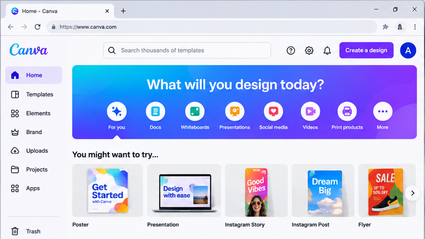
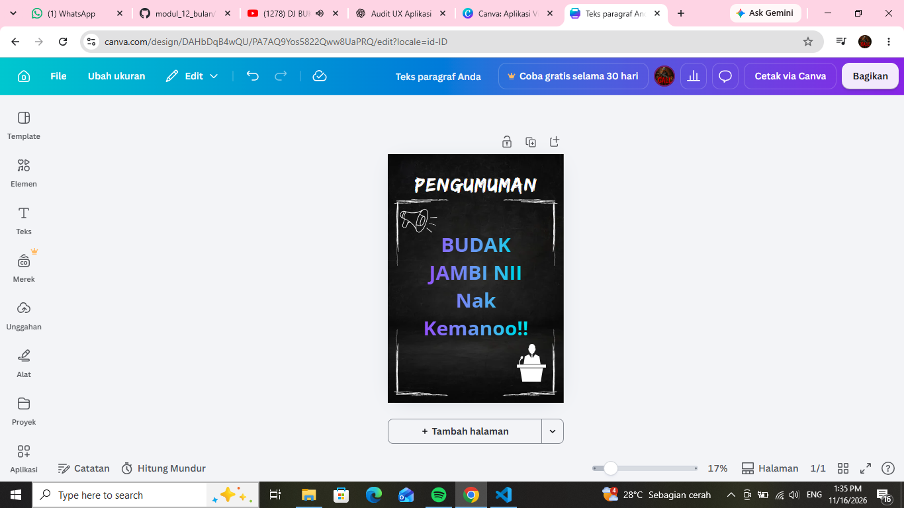
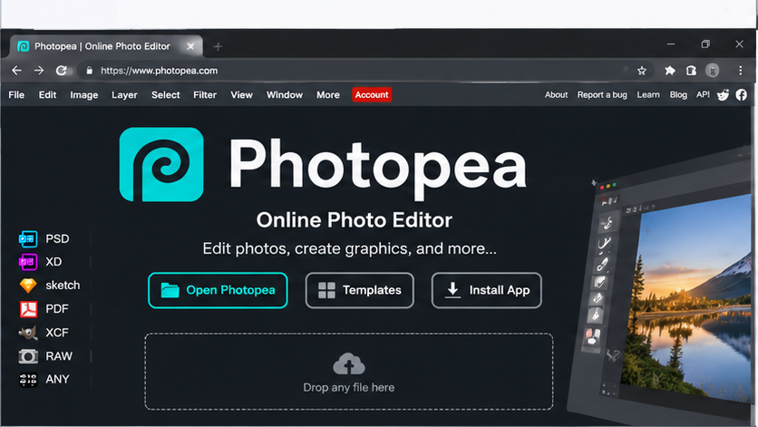
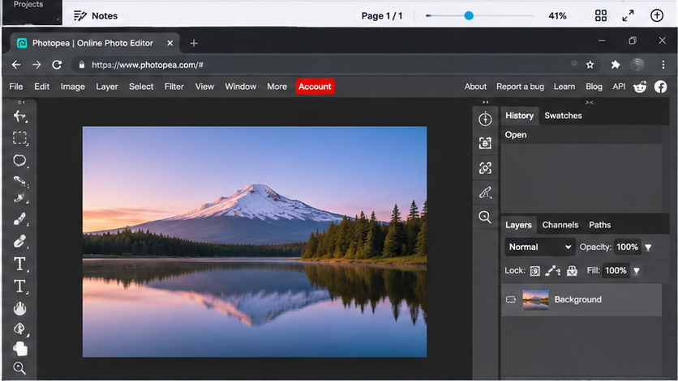

# Nak Kemano
# AUDIT UX SQUAD
## Audit UX Aplikasi Nyata

**Nama Squad:** [Isi nama squad]  
**Anggota Squad:** [Isi nama anggota]  
**Tanggal:** 16 November 2026  
**Topik:** Audit UX Aplikasi Nyata

---

## LANGKAH 1 — PILIH PASANGAN APLIKASI

Pada kegiatan ini, kami memilih dua aplikasi untuk dibandingkan, yaitu Canva dan Photopea.

### 1. Canva (UX Nyaman +)

Canva adalah aplikasi desain grafis online yang membantu pengguna membuat poster, presentasi, dan konten media sosial.

Alasan memilih Canva:
- Menu mudah ditemukan.
- Tersedia banyak template.
- Pengguna pemula mudah memulai desain.
- Proses pengeditan mudah dipahami.

**Screenshot Canva:**

### 2. Photopea (UX Pembanding -)

Photopea adalah aplikasi desain grafis online yang digunakan untuk mengedit foto dan membuat desain.

Alasan memilih Photopea:
- Memiliki banyak ikon dan alat pengeditan.
- Beberapa fitur membutuhkan pengetahuan khusus.
- Panel Layers cukup sulit dipahami oleh pemula.
- Pengguna baru membutuhkan waktu untuk memahami fungsi tombol.

**Screenshot Photopea:**

---

## LANGKAH 2 — TABEL AUDIT 4 PRINSIP EMAS UX

| Prinsip Emas UX | Temuan di Aplikasi Nyaman (+) Canva | Temuan di Aplikasi Pembanding (-) Photopea | Saran Perbaikan Konkret |
|---|---|---|---|
| 1. Kebiasaan Pengguna (Pola familiar) | Menu Home, Templates, Projects, dan tombol pencarian mudah dikenali. Pengguna dapat menemukan pilihan desain dengan cepat. | Banyak ikon alat seperti Crop, Brush, Eraser, dan Move yang membutuhkan pemahaman fungsi terlebih dahulu. | Tambahkan nama atau keterangan pada setiap ikon agar pengguna baru mengetahui kegunaannya. |
| 2. Tombol & Jangkauan Jempol (CTA jelas) | Tombol Create a design terlihat jelas. Pilihan template memudahkan pengguna memulai pekerjaan. | Toolbar memiliki banyak tombol kecil yang berdekatan sehingga pengguna pemula bisa salah memilih alat. | Perbesar tombol penting, beri jarak antarikon, dan kelompokkan tombol berdasarkan fungsi. |
| 3. Visibilitas Status Sistem (Loading/Error) | Perubahan desain dapat langsung dilihat. Status penyimpanan desain membantu pengguna mengetahui proses penyimpanan. | Pengguna pemula mungkin kesulitan mengetahui apakah perubahan sudah tersimpan atau proses tertentu masih berjalan. | Berikan indikator proses dan informasi penyimpanan yang jelas, termasuk pesan jika terjadi kegagalan. |
| 4. Pencegahan Kesalahan (Validasi/Form) | Pengguna dapat membatalkan perubahan menggunakan fitur Undo sehingga kesalahan pengeditan dapat diperbaiki. | Pengguna dapat salah mengubah layer, ukuran gambar, atau menggunakan alat pengeditan yang tidak sesuai. | Berikan petunjuk penggunaan alat, dukungan Undo/Redo yang mudah ditemukan, dan konfirmasi sebelum tindakan penting yang sulit dibatalkan. |

---

## LANGKAH 3 — 3 ATURAN UX WAJIB KATALOG UMKM

Berdasarkan hasil audit Canva dan Photopea, squad kami menyepakati tiga aturan UX wajib berikut:

### Aturan 1: Navigasi Harus Sederhana dan Mudah Dikenali

Setiap halaman Katalog UMKM wajib memiliki menu yang jelas, seperti Beranda, Produk, Kategori, Keranjang, dan Kontak. Gunakan nama menu dan ikon yang mudah dipahami pengguna.

### Aturan 2: Tombol Utama Harus Jelas dan Mudah Dijangkau

Tombol seperti Tambah ke Keranjang, Pesan Sekarang, dan Checkout harus memiliki tulisan yang jelas, ukuran yang mudah ditekan, serta posisi yang mudah ditemukan pengguna.

### Aturan 3: Sistem Harus Memberikan Informasi dan Mencegah Kesalahan

Setiap proses wajib menampilkan status loading, berhasil, atau gagal. Jika formulir gagal dikirim, data yang sudah diisi harus tetap tersimpan dan pesan kesalahan berbahasa Indonesia ditampilkan di bawah kolom yang bermasalah.

---

## KESIMPULAN

Dari kegiatan audit UX ini, kami memahami bahwa pengalaman pengguna bukan hanya tentang tampilan yang menarik, tetapi juga tentang kemudahan dalam menggunakan aplikasi.

Canva memberikan pengalaman yang lebih sederhana bagi pengguna pemula karena menu dan pilihan desain mudah ditemukan.

Photopea memiliki fitur pengeditan yang lebih kompleks sehingga pengguna pemula membutuhkan waktu untuk memahami beberapa alat dan fungsinya.

Dari hasil perbandingan tersebut, kami menyepakati tiga aturan UX wajib yang akan diterapkan pada Wireframe Katalog UMKM di Sesi 03b.

**Hasil akhir:** Dokumen Audit UX Squad siap dipresentasikan pada Daily Standup.